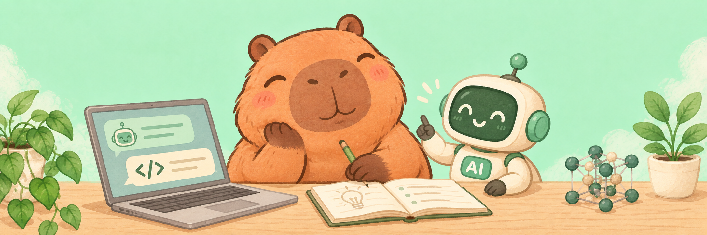

# Hi, I’m Bertil 👋

Exploring how AI and vibe coding can turn ideas from research and everyday life into practical tools.

探索用 AI 和 vibe coding，把研发与生活中的想法做成实用工具。

## What I’m exploring / 探索方向

- **AI × practical tools** — language input, meeting notes, and research workflows. 让 AI 融入输入、听记与研发工作流。
- **Agents × collaboration** — task delegation, permission-aware handoffs, and verifiable results. 探索 Agent 如何交接任务、遵守授权并交付可检查的结果。
- **Ideas × everyday making** — reading tools, CAD, and 3D printing. 把生活中的小需求，做成软件或可以拿在手里的东西。

## Selected projects

### [灵果 · LingoMate](https://github.com/jizw0704-source/lingomate)

A bilingual Pinyin input method for Windows and macOS: Chinese/English candidates, multiple translations, and local vocabulary learning. The macOS version also explores on-device and optional AI sentence translation.

中英双语拼音输入法：中文与英文候选、词语多译法、本地词汇学习；macOS 端还在探索本机与可选 AI 整句翻译。

`Rust · Swift` · `GPL-3.0-or-later` · `Early development / 早期开发与内测`

No public installation packages yet. 目前尚未提供公开安装包。

### [拾音 AI · Shiyin Meeting Notes](https://github.com/jizw0704-source/shiyin-ai-meeting-notes)

Local-first Chinese meeting notes with on-device transcription and speaker identification, plus optional AI summaries and editable meeting briefs.

听见讨论，看见下一步。本机转写与发言人识别，按需使用 AI 总结，整理成可编辑的会议简报。

`Local-first` · `Adapted project / 改造项目` · `Internal testing / 内测`

Adapted from [LightningFlashEvE’s project](https://github.com/LightningFlashEvE/shiyin-ai-meeting-notes). Currently `UNLICENSED`: publicly visible source does not grant reuse permission. AI summaries send meeting text to MiniMax only when requested.

基于上述项目持续改造。当前为 `UNLICENSED`，公开源码不等于开放使用授权；主动生成 AI 总结时，会议文本才会发送给 MiniMax。

### [3D Printing Projects / 3D 打印项目集](https://github.com/jizw0704-source/3d-printing-projects)

From everyday needs to CAD models and physical objects: a MacBook stand, a fishbone cable organizer, a shuttlecock pen holder, and a compact shoehorn.

从日常需求出发，做竖放支架、鱼骨收线器、羽毛球笔筒和小巧鞋拔；保留模型、打印参数与实物反馈。

`CAD · STEP · STL` · `MIT` · `Design → print → feedback`

The stand and cable organizer have been printed and tried; the other designs still await physical validation. 支架与收线器已打印并初步试用，其他作品仍待实物验证。

### [AI Agent Delegation Experiments / AI 跨工具委派实验](https://github.com/jizw0704-source/agent-delegation-experiments)

Field notes on Codex delegating work to WorkBuddy and other AI tools: task prompts, handoffs, delivery, and what was—and wasn’t—verified.

记录 Codex 委派 WorkBuddy 等 AI 工具完成任务的过程：怎么派任务、如何交接，以及哪些结果真正检查过。

`Experiment notes / 实验记录` · `Human-in-the-loop` · `Not a runnable framework / 非可运行框架`

## More explorations / 更多探索

### [IELTS Knowledge Reader](https://github.com/jizw0704-source/ielts-knowledge-reader)

A mobile-first reader for original IELTS-style articles, vocabulary, and short review sessions. Read for IELTS. Learn for life.

读原创英语知识文章、积累词汇、做短时复习。为雅思而读，为认知而学。

`JavaScript · PWA` · `Working prototype / 可体验原型` · [Try it / 在线体验](https://jizw0704-source.github.io/ielts-knowledge-reader/)

### [Agent Bridge](https://github.com/jizw0704-source/agent-bridge)

Exploring collaboration between personal AI agents, with their owners’ permission.

探索让不同人的专属 AI Agent 在各自主人的授权范围内交流与协作。

`MIT` · `Product & architecture exploration / 产品与架构探索`

Currently sharing requirements and design documents; no runnable service yet. 目前开放需求与设计文档，尚无可运行服务。

## A small note / 一点小想法

I enjoy turning unclear ideas into working prototypes—sometimes for research, sometimes for everyday life. Build, try, learn, and keep improving.

喜欢把模糊的想法变成能试用的东西：做出来，用一用，再慢慢改进。噜噜和 AI 小伙伴，会继续陪我探索。
